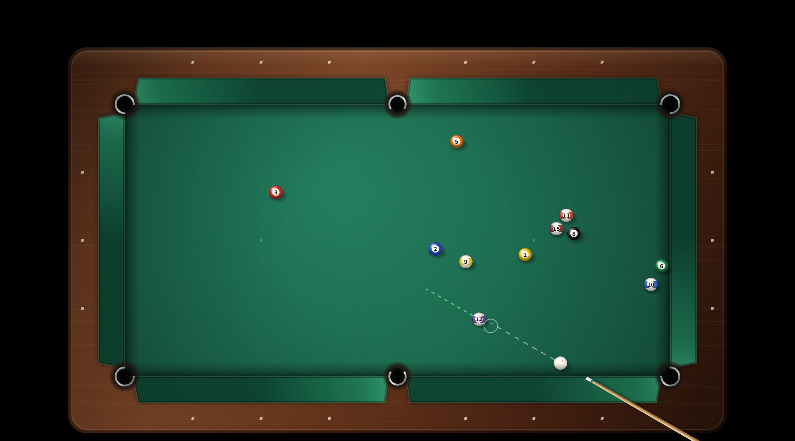

# 🎱 8 Ball Pool — Mesa Profissional

Uma recriação completa do 8 Ball Pool jogável no navegador: mesa 2:1 em perspectiva
plana, física de bolas de verdade, regras oficiais do 8-Ball, adversário com IA em
quatro níveis, mesa de treino, efeito (spin), som sintetizado e HUD no estilo do app.



**A única coisa fora do padrão:** as caçapas são do tamanho da bola.
Nos cantos a boca tem **1,27 × o diâmetro da bola** e nas laterais **1,32 ×**
(numa mesa comum é ~2,4 ×). Encaixar exige mira cirúrgica — é o que deixa o jogo
difícil e profissional.

---

## Como rodar

O jogo é 100% HTML + CSS + JavaScript (módulos ES), **sem build e sem dependências**
para jogar:

```bash
npm run dev        # http://localhost:5173
```

Ou sirva a pasta com qualquer servidor estático:

```bash
python3 -m http.server 5173
```

> Abrir o `index.html` direto por `file://` não funciona porque o navegador bloqueia
> módulos ES. Use o servidor (`npm run dev` ou o do Python).

## Como jogar

| Ação | Controle |
| --- | --- |
| Mirar | mover o mouse / arrastar o dedo |
| Ajuste fino | setas ← → (com **Shift** é mais fino) ou rodinha do mouse |
| Força | segurar o botão do mouse (ou **Espaço**) e soltar para tacar |
| Efeito | clicar no círculo da bola branca (canto inferior esquerdo) |
| Bola na mão | clicar numa posição livre da mesa |
| Linha de mira | botão **mira** (ou tecla G no menu Ajuda) |
| Pausa | **Esc** |

### Modos

- **1 jogador** — contra o computador em quatro níveis: Amador, Intermediário,
  Profissional e Lenda.
- **2 jogadores** — mesma mesa, alternando turnos.
- **Treino livre** — mesa aberta, 15 bolas, sem faltas. **Shift + clique** reposiciona
  a bola branca para treinar qualquer corte.

### Regras implementadas (8-Ball / WPA)

- Quebra válida: bola na caçapa **ou** 4 bolas diferentes tocando a tabela.
- Mesa aberta após a quebra; o grupo (lisas 1–7 / listradas 9–15) é definido pela
  primeira bola legal embolsada.
- Falta: branca na caçapa, não tocar em bola, tocar primeiro a bola errada, não
  levar nenhuma bola à tabela depois do contato, quebra inválida.
- Falta = **bola na mão** para o adversário.
- A 8 só vale depois de limpar o próprio grupo; embolsá-la antes é derrota.
- A 8 na quebra volta para o pé da mesa (não é vitória nem derrota).

## O que está por dentro

```
index.html          estrutura da interface
styles.css          HUD, menu e overlays
js/
  table.js          geometria da mesa, caçapas justas, triângulo inicial
  physics.js        colisões bola-bola/bola-tabela, atrito, efeito, captura
  rules.js          regras do 8-ball, faltas, turnos, bola na mão
  ai.js             adversário: leitura de corte, mira fantasma, simulação
  render.js         canvas: madeira, pano, borrachas, caçapas, bolas, taco
  audio.js          sons sintetizados (WebAudio), sem arquivos externos
  util.js           matemática e formatação
tools/              servidor local e testes
```

Detalhes técnicos que fazem diferença na jogabilidade:

- **Subpassos adaptativos na física** — a simulação divide o quadro conforme a
  velocidade, então nenhuma bola atravessa a tabela a 3.000 un/s.
- **Caçapa com captura por profundidade e desvio lateral** — a bola precisa entrar
  alinhada com a boca; raspar a mandíbula devolve a bola para a mesa.
- **Lei de atrito calibrada** para que a distância percorrida por uma bola dependa
  da força do jeito esperado — é o que a IA usa para calcular a potência da tacada.
- **IA com mão na frente:** ela monta a lista de encaixes possíveis (posição
  fantasma, ângulo de corte, linha livre), simula os melhores lances numa cópia do
  estado para confirmar, e só então aplica um erro de mira conforme a dificuldade.
- **Sprites de bola em cache** (canvas offscreen) e mesa estática pré-renderizada
  em alta resolução: o quadro sai leve mesmo em telas com DPR alto.

## Testes

```bash
npm install                 # só para as ferramentas (jsdom + canvas headless)
npm test                    # partida completa em DOM headless, com cliques reais
npm run test:rules          # partidas IA x IA validando física e regras
npm run test:shots          # imagens da mesa para conferência visual
node tools/screenshot.mjs   # regenera docs/mesa.jpg
```

O `npm test` cobre: menu, escolha de nível, tacada com mouse (segurar/soltar),
bola na mão, efeito, treino livre, dois jogadores, fim de partida e revanche —
tudo com eventos reais no DOM, verificando que nenhum erro de JavaScript acontece.

## Estatísticas

Vitórias, derrotas, bolas encaçapadas, melhor sequência e moedas ficam salvas no
`localStorage`. Cada vitória contra o computador rende 180 moedas, cada derrota 45.
